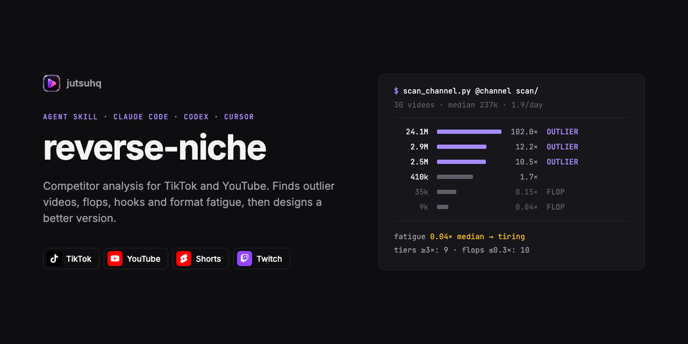

# reverse-niche: free TikTok and YouTube outlier finder and competitor analysis skill



[](LICENSE)
[](https://agentskills.io)
[](https://docs.claude.com/en/docs/claude-code/skills)

**reverse-niche** is a free, open-source agent skill that finds the outlier videos on any TikTok, YouTube or YouTube Shorts channel and explains why they worked.
It gives every video an **outlier score**: views divided by the channel's own median. A video at 3× or more is an outlier, a video at 0.3× or less is a flop.
Then the agent watches the outliers and the flops, finds what separates them, checks whether the format is dying, and designs a better version with episode ideas.

It runs in **Claude Code**, **Codex**, **Cursor** and any agent that reads [Agent Skills](https://agentskills.io) (`SKILL.md`).
Everything runs locally on `yt-dlp` and `ffmpeg`: no API key, no browser extension, no subscription.

- [Install](#install)
- [Usage](#usage)
- [Example](#example)
- [What it measures](#what-it-measures)
- [How it works](#how-it-works)
- [Compared with other tools](#compared-with-other-tools)
- [FAQ](#faq)
- [Contents](#contents)

## Install

```bash
npx skills add jutsuhq/reverse-niche-skill -a claude-code -g
```

Or copy `skills/reverse-niche` into your agent's skills folder, for example `~/.claude/skills/`.

Requirements: `ffmpeg`, plus `yt-dlp` or [`uv`](https://docs.astral.sh/uv/). With `uv` the scripts run `uvx yt-dlp`, so nothing else needs installing.

### Supported platforms

<p>
&nbsp;
&nbsp;
&nbsp;

</p>

| Platform | Works | Data available |
|---|---|---|
| TikTok profile | yes | views, likes, comments, shares, saves, length, date, sound |
| YouTube channel (`/videos`) | yes | views, length, approximate date |
| YouTube Shorts (`/shorts`) | yes | views only; no dates, so cadence is unknown |
| Twitch VODs | yes | views, length |
| Instagram, X | no | need a logged-in session |

## Usage

Ask your agent in plain words:

- "Find the outlier videos on tiktok.com/@channel and tell me why they worked."
- "Analyse this YouTube Shorts channel and design a better version of its format."
- "Compare these 4 TikTok accounts in my niche. Which formats work, which are dying?"
- "Is this TikTok format still growing or is the audience tired of it?"

The skill can also be run by hand:

```bash
python3 skills/reverse-niche/scripts/scan_channel.py https://www.tiktok.com/@channel scan/ --limit 60
skills/reverse-niche/scripts/download_videos.sh videos/ <outlier-url> <flop-url>
```

## Example

"Analyse this TikTok channel and design something better than it." The scan prints:

```
mindset_channel: 30 videos, 42,992,025 views, baseline 30 videos, median 237,250, mean 1,433,068, confidence high
mean is 6x the median: one or two hits dominate this channel, judge the rest without them
tiers: >=3x: 9  flops <=0.3x: 10
cadence: 1.9 videos/day over 16 days
fatigue: newest 10 median = 0.04x channel median ... -> tiring
```

The agent then watches the top 5 and 3 flops as contact sheets and writes a report:
numbers, format, what works, what flops, 7 weaknesses, a new design with a beat sheet, and episode ideas tied to the outliers they build on.
The full report is in [examples/sample-report.md](skills/reverse-niche/examples/sample-report.md).

## What it measures

| Metric | Formula | Why it matters |
|---|---|---|
| Outlier score | views ÷ channel median | compares a video with the creator's normal results, not with raw views |
| Tiers | ≥1.5×, ≥3×, ≥5×, ≥20× | 20× and above is usually a one-time cause, not a format |
| Flop | ≤0.3× median | the same format failing shows what the outliers did differently |
| Clean baseline | median without videos younger than 7 days and sponsored posts | new and paid videos would skew the median |
| Confidence | from the sample size: <5, 5–9, 10–19, 20+ settled videos | under 10 videos nothing is flagged |
| Engagement | likes, comments, shares, saves per 1000 views | saves point to useful content, shares to humour or identity |
| Engagement lift | engagement rate ÷ the channel's median rate | high lift with average views is an under-pushed idea worth retrying |
| Fatigue | newest 10 median ÷ channel median, and ÷ the previous 10 | below 0.5× the audience is tiring of the format |
| Hit rate | share of videos at ≥1× median, now vs before | a falling hit rate confirms fatigue |
| Title patterns | median outlier score per pattern (`vs`, number, question, POV, first person, how/why, list) | which title shapes work on this channel |
| Pace | cuts per 10 s, first cut time | one take or fast edit |

From watching the videos the agent adds the hook in three layers (seen, read, heard), the first payoff, the structure, voice, sound, captions, CTA and risks.

## How it works

1. **Scan.** `scan_channel.py` lists the channel with yt-dlp and writes a table with the outlier score, flags and engagement for every video.
2. **Watch.** `download_videos.sh` downloads only the outliers and 2–3 flops and makes a 24-frame contact sheet of each. Whisper transcribes the first 15 s.
3. **Compare.** The agent fills the same checklist for every video and compares outliers with flops in the same format. A concept that hits twice is a recipe; a single hit is a lead.
4. **Design.** Every weakness of the competitor gets a fix, plus one signature detail of your own. What cannot carry over to a new channel (fame, a news moment, a peaked sound) is struck out.
5. **Report.** Numbers, format, what works, what flops, weaknesses, design and 5–10 episode ideas.

## Compared with other tools

| | reverse-niche | Outlier browser extensions | vidIQ, TubeLab and similar | By hand |
|---|---|---|---|---|
| Outlier score against the channel median | yes | yes | yes | yes, with a spreadsheet |
| Runs locally, no account | yes | in your browser | no | yes |
| Watches the videos and explains the hook and structure | yes | no | no | yes, slowly |
| Compares outliers with flops in the same format | yes | no | no | yes, slowly |
| Format fatigue and hit rate | yes | no | not as a metric | no |
| Designs a better version with episode ideas | yes | no | no | no |

Browser extensions such as SortViral or Sort Feed are the fastest way to sort a profile you have open.
reverse-niche starts where they stop: it explains why the outliers won and what to make next.

### Other agent skills: ScrapeCreators and TubeLab

| | reverse-niche | [ScrapeCreators skills](https://github.com/ScrapeCreators/social-media-research-skills) | [TubeLab skills](https://github.com/TubeLabHQ/youtube-research-skills) |
|---|---|---|---|
| Platforms | TikTok, YouTube, YouTube Shorts, Twitch | TikTok, Instagram, YouTube, Reddit, X, LinkedIn, Facebook, Threads and more | YouTube |
| Needs | `yt-dlp` and `ffmpeg` | a ScrapeCreators API key (paid credits) | a TubeLab account and its MCP server (searches cost credits) |
| Data source | public pages, fetched on your machine | ScrapeCreators API | TubeLab database |
| Outlier ratio against the channel baseline | yes | yes | yes |
| Reads the video itself | contact sheets of frames, cuts, first 15 s transcript | transcripts | transcripts and thumbnails |
| Format fatigue and hit rate | yes | not documented | not documented |
| Scope | one job: a niche teardown and a better design | many skills: comments, ads, transcripts, competitor teardowns | many skills: niche finding, thumbnails, sponsors, monetization risk |

Pick ScrapeCreators for Instagram, X or ad libraries, and TubeLab for searching across all of YouTube for new niches.
Pick reverse-niche when you already know the channels and want a free, local teardown of TikTok or Shorts.

## FAQ

**How do I find outlier videos on a competitor's TikTok account for free?**
Take the channel's last 30–60 videos, compute the median views, and divide each video's views by that median. Videos at 3× or more are outliers.
`scan_channel.py` does this from a profile URL and leaves out videos younger than a week, whose views are still growing.

**What is an outlier score?**
Views divided by the channel's median views. It shows how a video did compared with that creator's normal results, so a 300k video on a 20k-median channel (15×) counts for more than 2M on a 5M-median channel (0.4×).

**How do I tell if a TikTok format is dying?**
Compare the median of the newest 10 videos with the channel median and with the 10 before them. Below 0.5× and a falling hit rate mean the audience is tiring of it. The scan prints both as `fatigue`.

**How do I reverse-engineer a viral TikTok?**
Watch it next to 2–3 flops from the same channel and format. Write down the hook in the first 3 s (what is seen, read and heard), the structure, length, sound and payoff for each. The difference between them is the formula.
[`references/video-checklist.md`](skills/reverse-niche/references/video-checklist.md) lists every field.

**Does it work for YouTube Shorts and long-form YouTube?**
Yes. yt-dlp lists any channel, Shorts tab or playlist. Shorts listings carry no upload dates, so cadence is unknown and fatigue follows the listing order.

**Can it see retention, watch time or click-through rate?**
No. Those numbers are visible only to the channel owner. The skill never estimates them for a competitor.

**Do I need vidIQ, TubeLab or another paid account?**
No. It uses public data through yt-dlp.

**How is it different from ScrapeCreators or TubeLab skills?**
Both are agent skill sets built on a paid data API: ScrapeCreators covers many social networks, TubeLab covers YouTube with its own database. reverse-niche needs no key or account, fetches public data on your machine, and watches the videos as frame sheets. See [the comparison](#other-agent-skills-scrapecreators-and-tubelab).

**Will it copy my competitor?**
No. It keeps what makes the genre recognisable and designs an original version. It never copies names, characters, logos or scripts.

## Contents

```
skills/reverse-niche/
  SKILL.md                        the workflow the agent follows
  scripts/scan_channel.py         channel → table with outlier scores + summary (yt-dlp, Python stdlib only)
  scripts/download_videos.sh      chosen videos → duration, pace, 24-frame contact sheet
  references/video-checklist.md   what to extract from each video
  references/hook-patterns.md     hook and title taxonomy, loops, borrowing formats from other niches
  references/report-template.md   the report layout
  examples/sample-report.md       a full worked report
```

## License

MIT. See [LICENSE](LICENSE).
